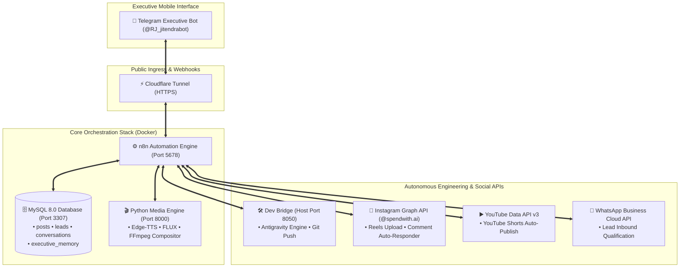

# 🪐 SocialAgent OS
### Autonomous AI Digital Agency & Multi-Platform Operations Engine

[](https://www.docker.com/)
[](https://n8n.io/)
[](https://www.mysql.com/)
[](https://fastapi.tiangolo.com/)
[](https://telegram.org/)
[](https://developers.facebook.com/)

**SocialAgent OS** is a self-contained, enterprise-grade autonomous digital agency and social media growth system. It transforms manual agency operations—content ideation, vertical video production, multi-platform publishing, client qualification, and autonomous software development—into a fully automated, zero-cost operating pipeline commanded directly through a personal Telegram mobile chat.

---

## 🏛️ System Architecture & Topology



---

## 🚀 Key Functional Modules

### 1. 🤖 Nova — Executive AI Chief of Staff & Memory Engine
- **Persistent Long-Term Memory**: Ingests and stores executive directives, business rules, and preferences in MySQL `executive_memory`.
- **Top-of-Mind Retrieval**: Before generating answers, queries top-ranked memories and contextual history, guaranteeing Nova never forgets prior decisions.
- **Commands**:
  - `/status` — Real-time health metrics of MySQL, Media Engine, and post counts.
  - `/post <topic>` — Triggers autonomous vertical short/reel generation.
  - `/remember <fact>` — Permanently commits executive business directives into memory.
  - `/recall <query>` — Performs semantic text searches over stored memory.
  - `/buildsite <name>` — Scaffolds, tests, and deploys full responsive web applications.

### 2. 🎬 Zero-Cost Programmatic Media Engine (`services/media_engine`)
- **FastAPI Microservice** operating in Docker (`agency-media-engine` on port 8000).
- **Edge-TTS Neural Voiceovers**: Generates studio-quality voice narration without commercial API fees.
- **Pollinations.ai / Hugging Face FLUX**: Automatically renders 9:16 vertical scene artwork.
- **FFmpeg & MoviePy Compositor**: Renders 1080x1920 vertical MP4 videos with smooth Ken Burns pan/zoom and center-aligned dynamic subtitles.

### 3. 📸 Instagram Reels & Real-Time Comment Auto-Responder
- **Verified Business Account**: `@spendwith.ai` (Canonical Business ID: `17841425833721941`).
- **Autonomous Publishing**: Uses the official Meta Graph API Reels Container flow (`POST /media` with `media_type=REELS` & `video_url`).
- **Live Comment Auto-Responder (`workflows/instagram_comment_bot.json`)**:
  - Ingests Meta Webhook comments in real time.
  - Synthesizes personalized, warm, brand-aligned replies under 20 words with 1 emoji using Gemini AI.
  - Automatically posts the reply back to the viewer via `POST /{comment_id}/replies`.
  - Logs the viewer interaction into `executive_memory` and alerts the Telegram admin.

### 4. 🛠️ Autonomous Web Dev Bridge (`services/dev_bridge`)
- Python service on host port 8050.
- Accepts structured project briefs from WhatsApp/Telegram, scaffolds production React/Vite/Tailwind landing pages, executes local compilation tests (`npm run build`), commits to Git, and triggers cloud hosting (Render/Vercel).

---

## 📦 Directory Structure

```plaintext
socialAgent/
├── docker-compose.yml              # Local container stack (n8n, mysql, media-engine)
├── .env.example                    # Comprehensive secret specification template
├── init.sql                        # MySQL 8.0 schema (posts, leads, memory tables)
├── RUNBOOK.md                      # Operational startup and management guide
├── progress.md                     # Roadmap, phase status, and verified milestones
├── workflows/                      # Production n8n workflow definitions
│   ├── telegram_dispatcher.json    # Telegram Command Gate & Conversational Nova
│   ├── social_pipeline.json        # 9 AM Content Generator & Preview Card
│   ├── callback_handler.json       # Interactive Button Action Handler
│   ├── social_publisher.json       # Multi-platform Reels & Shorts Publisher
│   ├── instagram_comment_bot.json  # Real-time Reel Comment Auto-Responder
│   ├── whatsapp_agent.json         # WhatsApp Lead Qualification & Scaffolder
│   └── analytics_feedback.json     # 24-Hour Performance Advisory Loop
├── services/
│   ├── media_engine/               # FastAPI microservice for TTS and video compositing
│   └── dev_bridge/                 # Local host bridge for automated web engineering
└── shared_media/                   # Shared volume for rendered MP3s, visuals, and MP4s
```

---

## ⚡ Quickstart Deployment

### 1. Configure Credentials
```bash
cp .env.example .env
```
Fill in the credentials in `.env`:
- `TELEGRAM_BOT_TOKEN` & `TELEGRAM_ADMIN_ID`
- `GEMINI_API_KEY` (See instructions below for using Gemini Pro from Google AI Studio)
- `INSTAGRAM_ACCOUNT_ID` (`17841425833721941`) & `INSTAGRAM_ACCESS_TOKEN`
- `MYSQL_ROOT_PASSWORD` & `MYSQL_PASSWORD`

### 2. Boot Core Container Stack
```bash
docker compose up -d --build
```
Verify running containers:
```bash
docker compose ps
```

### 3. Start Host Dev Bridge
```bash
python services/dev_bridge/bridge_server.py
```

### 4. Start Cloudflare Ingress Tunnel
```bash
cloudflared tunnel --url http://localhost:5678
```

---

## 🧠 Using Gemini Pro (`ur.jitendra.io@gmail.com`) for Higher Credits & Nova Memory

You can connect your Google account (`ur.jitendra.io@gmail.com`) to unlock **Gemini Pro**:

### 1. Generating Your Gemini Pro API Key
1. Go to [Google AI Studio](https://aistudio.google.com/) and sign in with **`ur.jitendra.io@gmail.com`**.
2. Click **Get API key** &rarr; **Create API Key**.
3. Copy the resulting key (`AIzaSy...`).
4. Update your `.env` file:
   ```env
   GEMINI_API_KEY=AIzaSyYourGeneratedProKeyHere
   ```
5. Restart n8n to pick up the updated key:
   ```bash
   docker restart agency-n8n
   ```

### 2. How Nova Remembers Conversations
- **Persistent Storage**: Every conversation with `@RJ_jitendrabot` and every social interaction is preserved in MySQL `executive_memory`.
- **Automatic Context Ingestion**: Nova queries the top 10 most relevant memories and past conversation context on every message, embedding them into the prompt sent to Gemini.
- **Gemini Pro 1M+ Context Advantage**: With Gemini Pro, you benefit from a massive **1 Million to 2 Million token context window**. Nova can retain weeks of strategic context, business rules, client preferences, and past chat nuances without loss of detail.
- **Manual Control**:
  - Send `/remember We only offer custom bespoke packages starting at $2,500` &rarr; Nova permanently commits this to memory.
  - Send `/recall pricing` &rarr; Nova immediately surfaces the stored pricing directives.

---

## 🛡️ License
Private and confidential. Built for autonomous digital operations.
